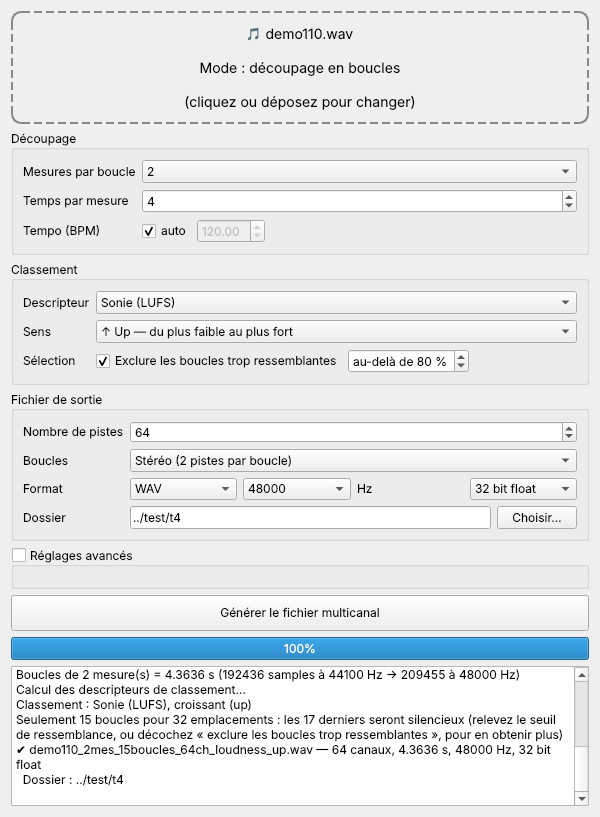

# MultiLoop Slicer

*[English version](README.md)*

Petite application autonome pour le **design sonore interactif** : elle découpe un morceau audio en boucles synchrones de même longueur calées sur les mesures, **choisit les plus différenciées**, les **classe selon un descripteur sonore** (sonie, énergie, brillance, harmonicité, activité rythmique…) et écrit **un seul fichier multicanal** (boucle 1 → canaux 1-2, boucle 2 → canaux 3-4, …).

Toutes les boucles ont exactement la même longueur en échantillons et commencent sur un premier temps de la même grille de phrases : elles peuvent être permutées ou mixées à tout moment.

Le fichier se joue ensuite avec l'objet Max for Live **`MultiChannelLoop-Browser_05.amxd`** (dossier `max/`), qui permet de passer continûment d'une boucle à l'autre, par exemple de la plus calme à la plus active, en fonction d'un paramètre de contrôle (geste, capteur, interaction…).



---

## Notice d'utilisation

### 1. Installer (une seule fois)

Il faut **Python 3.10 ou plus récent** ([python.org](https://www.python.org/downloads/)) et une connexion internet la première fois.

1. Téléchargez ce dépôt (bouton vert **Code → Download ZIP**) et décompressez-le.
2. Double-cliquez sur **`MultiLoop Slicer.command`**.
   - La première fois, macOS peut bloquer le fichier : **clic droit → Ouvrir**, puis confirmer.
   - Le premier lancement installe ce qu'il faut (quelques minutes). Les suivants sont immédiats.

> Sans le lanceur (Linux, Windows ou Terminal) :
> ```bash
> python3 -m venv .venv
> .venv/bin/pip install -r requirements.txt     # Windows : .venv\Scripts\pip
> .venv/bin/python -m loopslicer
> ```

### 2. Utiliser

1. **Glissez-déposez** un fichier audio (wav, aiff, flac, mp3) sur la zone en pointillés, ou cliquez dessus pour parcourir.
   - **Un fichier** → mode *découpage* : le morceau est découpé en boucles.
   - **Plusieurs fichiers, ou un dossier** → mode *assemblage* : chaque fichier est une boucle (par exemple des bounces de Logic ou de Live).
2. **Découpage** : nombre de **mesures par boucle** (2 par défaut), **temps par mesure** (4), **tempo** détecté automatiquement, ou saisi à la main si la détection se trompe.
3. **Classement** : choisissez le **descripteur** et le **sens** :
   - **↑ Up** : de la valeur la plus faible à la plus forte (canaux 1-2 = la boucle la plus douce, la plus calme, la plus sombre…),
   - **↓ Down** : l'inverse.
   - **Exclure les boucles trop ressemblantes** (coché par défaut, seuil 80 %) : quand le morceau offre plus de boucles possibles que de pistes, ou contient des passages répétés (refrains, boucles recopiées, bounces en double), on ne garde qu'une boucle par famille de boucles qui se ressemblent. Baissez le seuil (ex. 60 %) pour être plus sévère, et donc obtenir moins de boucles mais plus contrastées ; relevez-le (ex. 95 %) pour n'écarter que les quasi-doublons ; décochez pour tout garder.
4. **Fichier de sortie** :
   - **Nombre de pistes** = nombre de canaux du fichier (64 par défaut, soit 32 boucles stéréo au maximum). En *auto*, toutes les boucles retenues par la sélection sont gardées. S'il y a moins de boucles différenciées que d'emplacements, les derniers canaux restent silencieux : relevez le seuil de ressemblance, ou décochez l'exclusion, pour en obtenir plus.
   - **Boucles** : stéréo (2 pistes par boucle) ou mono (1 piste).
   - **Format** : WAV ou AIFF, fréquence d'échantillonnage, résolution. **Par défaut : WAV 48 kHz 32 bits flottants.**
   - **Dossier** : où écrire les fichiers (par défaut, un dossier `<nom du fichier>_Loops` à côté du fichier source). L'application mémorise vos réglages d'une fois sur l'autre.
5. Cliquez **Générer**. À la fin, le fichier est montré dans le Finder. Le journal en bas de la fenêtre indique le tempo trouvé, la position de la mesure 1 et les éventuels avertissements.

### 3. Réglages avancés (cochez la case pour les afficher)

À utiliser si l'écoute révèle un problème de calage ou de sélection :

| Réglage | Quand s'en servir |
|---|---|
| **Grille de phrase** (2) | les boucles ne démarrent que toutes les N mesures, pour respecter le phrasé (4 ou 8 pour une musique en carrures de 4 ou 8 mesures) |
| **Correction du 1er temps** | la boucle démarre sur le 2e, 3e ou 4e temps au lieu du 1er : indiquez le décalage en temps (+1, −1…) |
| **Correction de phrase** | la boucle démarre au milieu d'une phrase : décalez d'une mesure |
| **Décalage fin de la grille** | les attaques sont coupées (valeur négative) ou arrivent en retard (positive), en ms |
| **Pré-roll** | démarre chaque boucle quelques ms avant le temps pour garder l'attaque entière |
| **Micro-fondus** (1 ms) | fondus anti-clic en cosinus aux deux extrémités ; 0 = coupe franche |
| **Ignorer en dessous de** (−45 LUFS) | écarte les passages trop faibles (silences, fins de morceau) |
| **Exporter chaque boucle** | écrit aussi un fichier par boucle, dans un sous-dossier |

### 4. Ce qu'on obtient

Pour une source `morceau.wav`, boucles de 2 mesures, 32 boucles retenues, classées par activité en sens croissant, sur 64 pistes :

| Fichier | Contenu |
|---|---|
| `morceau_2mes_32boucles_64ch_activity_up.wav` | le fichier multicanal à charger dans l'objet Max for Live |
| `…_index.csv` | une ligne par boucle : rang, canaux, mesure de départ, instant et sample exact dans la source, distinctivité, ressemblance (en %) avec la plus proche des autres boucles retenues, valeurs de tous les descripteurs |
| `…_analyse.json` | tempo, premier temps, mesure 1, écarts de grille, réglages utilisés |
| `…/` (option) | un fichier par boucle, nommé par exemple `01_-23.4LUFS_mes017.wav` |

Le CSV s'ouvre dans Excel ou Numbers : il permet de retrouver de quel passage du morceau provient chaque paire de canaux.

### 5. Jouer dans Ableton Live

1. Placez **`max/MultiChannelLoop-Browser_05.amxd`** sur une piste audio de Live.
2. Chargez-y le fichier multicanal produit.
3. Les canaux étant classés par descripteur, parcourir les boucles avec l'objet revient à voyager dans le son selon ce descripteur : du plus doux au plus fort, du plus calme au plus actif, etc.

<!-- TODO : décrire ici les commandes de l'objet (paramètres, mapping MIDI / OSC). -->

---

## Descripteurs

| Descripteur | Ce qu'il mesure | Méthode |
|---|---|---|
| **Sonie (LUFS)** | volume perçu | sonie intégrée, ITU-R BS.1770 / EBU R128 (`pyloudnorm`) |
| **Énergie (RMS dB)** | énergie brute du signal, sans pondération perceptive | niveau RMS en dBFS |
| **Brillance** | timbre clair ou sombre | centroïde spectral pondéré par l'énergie (Hz) |
| **Harmonicité** | contenu tonal vs bruit et percussions | part harmonique après séparation harmonique/percussive (HPSS), × (1 − platitude spectrale) |
| **Activité rythmique** | calme ↔ agité, impulsif | moyenne de 4 composantes centrées-réduites : densité d'attaques (onsets/s), impulsivité (pics / médiane de l'enveloppe d'attaques), part percussive (HPSS), fluctuation de l'enveloppe (écart-type / moyenne du RMS) |
| **Distinctivité** | — | ordre dans lequel la sélection a choisi les boucles (la plus singulière d'abord) |
| **Position d'origine** | — | ordre chronologique dans le fichier source |

L'indice d'**activité rythmique** est relatif : il est calculé par rapport à l'ensemble des boucles du fichier (chaque composante est centrée et réduite). Les composantes détaillées figurent dans le CSV, pour construire votre propre classement.

---

## Méthode

**Mode découpage (un fichier)** — reprend la méthode du script `loop_slicer.py` (voir `original/`) :

1. **Tempo** : estimation initiale (`librosa`), puis recherche fine du couple (tempo, phase) qui maximise l'enveloppe d'attaques sur une grille régulière (pas de 0,002 BPM, phase à ~0,5 ms près). Le tempo est arrondi au BPM entier s'il en est très proche (cas des exports de DAW).
2. **Contrôle de dérive** : la grille est recalée par fenêtres de 15 s ; un écart de plus de 25 ms signale un tempo non constant (avertissement dans le journal).
3. **Premier temps** : parmi les 4 temps possibles, celui qui combine le plus fort changement spectral (chroma + MFCC, synchronisé sur les temps) et les attaques graves (30-120 Hz).
4. **Grille de phrase** : parmi les mesures possibles, celle où tombent les plus grands changements de section.
5. **Candidats** : toutes les positions de N mesures qui démarrent sur la grille de phrase. Leur longueur est calculée sur la grille théorique (pas de dérive) : **toutes ont exactement le même nombre d'échantillons**.
6. **Sélection des plus différenciées** : chaque candidat est décrit par son timbre (MFCC), son harmonie (chroma), sa texture (contraste spectral, bandes de fréquences, attaques, largeur stéréo) et sa sonie. On part de la boucle la plus singulière, puis on ajoute à chaque fois celle qui est la plus éloignée de toutes celles déjà choisies, sans chevauchement, dans la limite du nombre de pistes. Si l'exclusion est active, la sélection s'arrête dès que toutes les candidates restantes ressemblent trop à une boucle déjà retenue.

   La **ressemblance** est exprimée par rapport à la distance médiane entre toutes les boucles du morceau : 100 % = identiques, 0 % = aussi différentes que deux boucles prises au hasard. Le seuil de 80 % par défaut équivaut au réglage `--min-dist 0.5` du script d'origine (mêmes boucles retenues).
7. **Conversion** au format demandé (rééchantillonnage *soxr* haute qualité si besoin), mono ou stéréo, **micro-fondus** de 1 ms.
8. **Classement** des boucles retenues selon le descripteur choisi, puis écriture.

**Mode assemblage (plusieurs fichiers)**

- La longueur de référence est la médiane des longueurs : les fichiers qui diffèrent de quelques samples (typique des bounces) sont complétés ou raccourcis ; un fichier **exactement deux fois plus court** est joué deux fois (boucle doublée).
- Les fichiers trop ressemblants sont écartés (même méthode qu'au point 6), ainsi que ceux en trop s'il y a plus de fichiers que de pistes. Le journal indique, pour chaque fichier écarté, à quel fichier il ressemble et à combien de % : un doublon exact apparaît à 100 %.

---

## Limites

- Le morceau doit avoir un **tempo fixe** (export de DAW, musique programmée). Rubato, accelerando ou musique jouée sans clic donneront une grille approximative (le journal le signale) : imposez le tempo, ou préparez les boucles dans un DAW et utilisez le mode *assemblage*.
- Le premier temps est deviné à partir des changements spectraux et des attaques graves : sur une musique sans grosse caisse ni basse, vérifiez à l'écoute et corrigez avec *Correction du 1er temps* (la mesure de départ de chaque boucle est dans le CSV).
- Le WAV est limité à 4 Go : au-delà, le fichier est écrit en RF64 automatiquement.
- En 16, 24 ou 32 bits entiers, un niveau au-dessus de 0 dBFS écrête (un avertissement s'affiche). Le 32 bits flottants par défaut évite ce problème.

---

## Ligne de commande

Le même moteur peut être utilisé en script, par exemple pour traiter un lot de fichiers :

```bash
.venv/bin/python -m loopslicer morceau.wav -m 2 -d activity --order up -t 64
.venv/bin/python -m loopslicer morceau.wav --bpm 110 --downbeat-shift 1 --individual
.venv/bin/python -m loopslicer bounces/*.wav -d loudness --order down --mono
.venv/bin/python -m loopslicer morceau.wav --similarity 60      # plus sévère
.venv/bin/python -m loopslicer morceau.wav --keep-similar       # garder toutes les boucles
.venv/bin/python -m loopslicer --help
```

## Construire une application macOS (.app)

```bash
./build_app.sh        # → dist/MultiLoop Slicer.app
```

Le `.app` contient Python et toutes les dépendances (environ 300 à 500 Mo). Il peut être distribué sans rien installer, mais comme il n'est pas signé, vos collègues devront l'ouvrir la première fois par **clic droit → Ouvrir**.

## Contenu du dépôt

```
loopslicer/engine.py      analyse, découpage, sélection, descripteurs, export
loopslicer/gui.py         interface graphique (PySide6)
loopslicer/cli.py         ligne de commande
max/                      objet Max for Live MultiChannelLoop-Browser_05.amxd
original/loop_slicer.py   script d'origine (ligne de commande, classement par sonie)
MultiLoop Slicer.command  lanceur macOS (double-clic)
build_app.sh              construit l'application .app avec PyInstaller
```

## Licence

MIT — voir [LICENSE](LICENSE).

## Crédits

Roland Cahen — ENSCi Les Ateliers, CRD, dans le cadre de la thèse de Louise Grebel.
L'application reprend l'analyse et la sélection du script `loop_slicer.py` : à réglages égaux et à la même fréquence d'échantillonnage, elle produit les mêmes boucles, au sample près.
