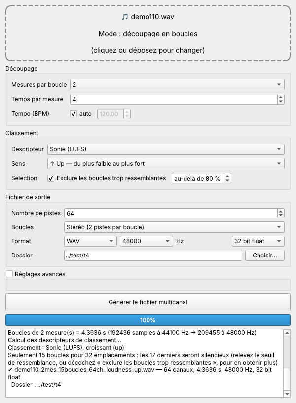

# MultiLoop Slicer

*[Version française](README.fr.md)*

A small standalone application for **interactive sound design**. It cuts an audio piece into synchronous loops of equal length aligned to the bar grid, **keeps the most distinct ones**, **sorts them by a sound descriptor** (loudness, energy, brightness, harmonicity, rhythmic activity…) and writes **a single multichannel file** (loop 1 → channels 1-2, loop 2 → channels 3-4, …).

All loops have exactly the same length in samples and start on a downbeat of the same phrase grid, so they can be swapped or mixed at any moment.

The file is then played with the Max for Live device **`MultiChannelLoop-Browser_05.amxd`** (`max/` folder), which lets you move continuously from one loop to another — for instance from the calmest to the most active — driven by a control parameter (gesture, sensor, interaction…).



> The interface is in French. Labels are given below as **French label** (English meaning).

---

## User guide

### 1. Install (once)

You need **Python 3.10 or later** ([python.org](https://www.python.org/downloads/)) and an internet connection the first time.

1. Download this repository (green **Code → Download ZIP** button) and unzip it.
2. Double-click **`MultiLoop Slicer.command`**.
   - The first time, macOS may block the file: **right-click → Open**, then confirm.
   - If nothing happens, open Terminal in the folder and run
     `chmod +x "MultiLoop Slicer.command" && xattr -dr com.apple.quarantine .`
   - The first launch installs the dependencies (a few minutes). Later launches are immediate.

> Without the launcher (Linux, Windows or Terminal):
> ```bash
> python3 -m venv .venv
> .venv/bin/pip install -r requirements.txt     # Windows: .venv\Scripts\pip
> .venv/bin/python -m loopslicer
> ```

### 2. Use

1. **Drag and drop** an audio file (wav, aiff, flac, mp3) onto the dashed area, or click it to browse.
   - **One file** → *slicing* mode: the piece is cut into loops.
   - **Several files, or a folder** → *merge* mode: each file is one loop (e.g. bounces from Logic or Live).
2. **Découpage** (slicing): **Mesures par boucle** (bars per loop, default 2), **Temps par mesure** (beats per bar, 4), **Tempo** detected automatically (*auto*) or typed in if detection is wrong.
3. **Classement** (sorting):
   - **Descripteur**: the descriptor used to order the loops.
   - **Sens** (direction): **↑ Up** = from the lowest value to the highest (channels 1-2 = the softest / calmest / darkest… loop); **↓ Down** = the reverse.
   - **Exclure les boucles trop ressemblantes, au-delà de 80 %** (exclude loops that are too similar, above 80 %) — *on by default*. When the piece offers more possible loops than tracks, or contains repeated passages (choruses, copied loops, duplicate bounces), only one loop per family of similar loops is kept. Lower the threshold (e.g. 60 %) to be stricter — fewer but more contrasted loops; raise it (e.g. 95 %) to drop only near-duplicates; untick to keep everything.
4. **Fichier de sortie** (output file):
   - **Nombre de pistes** (number of tracks) = channels in the output file (default 64, i.e. up to 32 stereo loops). *auto* keeps every loop the selection retains. If there are fewer distinct loops than slots, the remaining channels are silent: raise the similarity threshold, or untick the exclusion, to get more.
   - **Boucles**: stereo (2 tracks per loop) or mono (1 track).
   - **Format**: WAV or AIFF, sample rate, bit depth. **Default: WAV 48 kHz 32-bit float.**
   - **Dossier** (folder): where files are written (default: a `<file name>_Loops` folder next to the source). Settings are remembered between sessions.
5. Click **Générer le fichier multicanal** (generate). When done, the file is revealed in the Finder. The log at the bottom shows the detected tempo, the position of bar 1 and any warnings.

### 3. Advanced settings (*Réglages avancés* — tick to show)

Use them if listening reveals an alignment or selection problem:

| Setting | When to use it |
|---|---|
| **Grille de phrase** (phrase grid, 2 bars) | loops only start every N bars, to respect phrasing (4 or 8 for music built in 4- or 8-bar phrases) |
| **Correction du 1er temps** (downbeat correction) | loops start on beat 2, 3 or 4 instead of 1: enter the offset in beats (+1, −1…) |
| **Correction de phrase** (phrase correction) | loops start mid-phrase: shift by one bar |
| **Décalage fin de la grille** (fine grid offset) | attacks are cut (negative value) or late (positive), in ms |
| **Pré-roll** | starts each loop a few ms before the beat to keep the whole attack |
| **Micro-fondus** (micro-fades, 1 ms) | raised-cosine anti-click fades at both ends; 0 = hard cut |
| **Ignorer en dessous de** (ignore below, −45 LUFS) | discards passages that are too quiet (silences, endings) |
| **Exporter chaque boucle** (export each loop) | also writes one file per loop, in a sub-folder |

### 4. Output

For a source `piece.wav`, 2-bar loops, 32 loops kept, sorted by activity ascending, on 64 tracks:

| File | Content |
|---|---|
| `piece_2mes_32boucles_64ch_activity_up.wav` | the multichannel file to load into the Max for Live device |
| `…_index.csv` | one row per loop: rank, channels, start bar, exact time and sample in the source, distinctiveness, similarity (%) to the closest other kept loop, all descriptor values |
| `…_analyse.json` | tempo, first beat, bar 1, grid deviations, settings used |
| `…/` (optional) | one file per loop, e.g. `01_-23.4LUFS_mes017.wav` |

The CSV opens in Excel or Numbers and tells you which passage of the piece each channel pair comes from.

### 5. Playing in Ableton Live

1. Put **`max/MultiChannelLoop-Browser_05.amxd`** on an audio track in Live.
2. Load the generated multichannel file into it.
3. Since the channels are sorted by descriptor, browsing the loops with the device means travelling through the sound along that descriptor: from softest to loudest, from calmest to most active, etc.

<!-- TODO: describe the device's controls here (parameters, MIDI / OSC mapping). -->

---

## Descriptors

| Descriptor (menu label) | What it measures | Method |
|---|---|---|
| **Loudness** (*Sonie, LUFS*) | perceived loudness | integrated loudness, ITU-R BS.1770 / EBU R128 (`pyloudnorm`) |
| **Energy** (*Énergie, RMS dB*) | raw signal energy, no perceptual weighting | RMS level in dBFS |
| **Brightness** (*Brillance*) | bright vs dark timbre | energy-weighted spectral centroid (Hz) |
| **Harmonicity** (*Harmonicité*) | tonal content vs noise and percussion | harmonic share after harmonic/percussive separation (HPSS) × (1 − spectral flatness) |
| **Rhythmic activity** (*Activité rythmique*) | calm ↔ busy, impulsive | mean of 4 standardised components: attack density (onsets/s), impulsiveness (peaks / median of the onset envelope), percussive share (HPSS), envelope fluctuation (std / mean of RMS) |
| **Distinctiveness** (*Distinctivité*) | — | order in which the selection picked the loops (most singular first) |
| **Original position** (*Position d'origine*) | — | chronological order in the source |

The **rhythmic activity** index is relative: it is computed with respect to the loops of the file (each component is standardised). The individual components are in the CSV if you want to build your own ordering.

---

## Method

**Slicing mode (one file)** — follows the method of the `loop_slicer.py` script (see `original/`):

1. **Tempo**: initial estimate (`librosa`), then a fine search for the (tempo, phase) pair that maximises the onset envelope on a regular grid (0.002 BPM steps, phase to ~0.5 ms). The tempo is rounded to a whole BPM when very close (typical of DAW exports).
2. **Drift check**: the grid is re-fitted over 15 s windows; a deviation above 25 ms flags a non-constant tempo (warning in the log).
3. **Downbeat**: among the 4 possible beats, the one combining the strongest spectral change (beat-synchronous chroma + MFCC) and low-frequency attacks (30-120 Hz).
4. **Phrase grid**: among the possible bars, the one where the biggest section changes fall.
5. **Candidates**: every N-bar position starting on the phrase grid. Lengths are computed from the theoretical grid (no drift): **every loop has exactly the same number of samples**.
6. **Selecting the most distinct loops**: each candidate is described by its timbre (MFCC), harmony (chroma), texture (spectral contrast, frequency bands, onsets, stereo width) and loudness. Starting from the most singular loop, the one farthest from all loops already chosen is added each time, without overlap, up to the number of tracks. When exclusion is on, selection stops as soon as every remaining candidate is too similar to a loop already kept.

   **Similarity** is expressed relative to the median distance between all loops of the piece: 100 % = identical, 0 % = as different as two loops taken at random. The 80 % default is equivalent to `--min-dist 0.5` in the original script (same loops kept).
7. **Conversion** to the requested format (high-quality *soxr* resampling if needed), mono or stereo, 1 ms **micro-fades**.
8. **Sorting** of the kept loops by the chosen descriptor, then writing.

**Merge mode (several files)**

- The reference length is the median length: files that differ by a few samples (typical of bounces) are padded or trimmed; a file **exactly half as long** is played twice (doubled loop).
- Files that are too similar are dropped (same method as step 6), as well as extra files if there are more files than tracks. The log says, for each dropped file, which file it resembles and by how much: an exact duplicate shows 100 %.

---

## Limitations

- The piece must have a **fixed tempo** (DAW export, programmed music). Rubato, accelerando or music played without a click will give an approximate grid (the log reports it): set the tempo manually, or prepare the loops in a DAW and use *merge* mode.
- The downbeat is inferred from spectral changes and low-frequency attacks: for music without kick or bass, check by ear and correct with *Correction du 1er temps* (each loop's start bar is in the CSV).
- WAV is limited to 4 GB: beyond that, the file is written as RF64 automatically.
- In 16-, 24- or 32-bit integer formats, levels above 0 dBFS clip (a warning is shown). The 32-bit float default avoids this.

---

## Command line

The same engine can be scripted, e.g. for batch processing:

```bash
.venv/bin/python -m loopslicer piece.wav -m 2 -d activity --order up -t 64
.venv/bin/python -m loopslicer piece.wav --bpm 110 --downbeat-shift 1 --individual
.venv/bin/python -m loopslicer bounces/*.wav -d loudness --order down --mono
.venv/bin/python -m loopslicer piece.wav --similarity 60      # stricter
.venv/bin/python -m loopslicer piece.wav --keep-similar       # keep every loop
.venv/bin/python -m loopslicer --help
```

## Building a macOS application (.app)

```bash
./build_app.sh        # → dist/MultiLoop Slicer.app
```

The `.app` bundles Python and all dependencies (about 300-500 MB) and can be shared without installing anything. As it is not signed, colleagues must open it the first time with **right-click → Open**.

## Repository contents

```
loopslicer/engine.py      analysis, slicing, selection, descriptors, export
loopslicer/gui.py         graphical interface (PySide6)
loopslicer/cli.py         command line
max/                      Max for Live device MultiChannelLoop-Browser_05.amxd
original/loop_slicer.py   original script (command line, loudness ordering)
MultiLoop Slicer.command  macOS launcher (double-click)
build_app.sh              builds the .app with PyInstaller
```

## License

MIT — see [LICENSE](LICENSE).

## Credits

Roland Cahen — ENSCi Les Ateliers, CRD, as part of Louise Grebel's PhD research.
The application reuses the analysis and selection of the `loop_slicer.py` script: with the same settings and sample rate, it produces the same loops, sample for sample.
